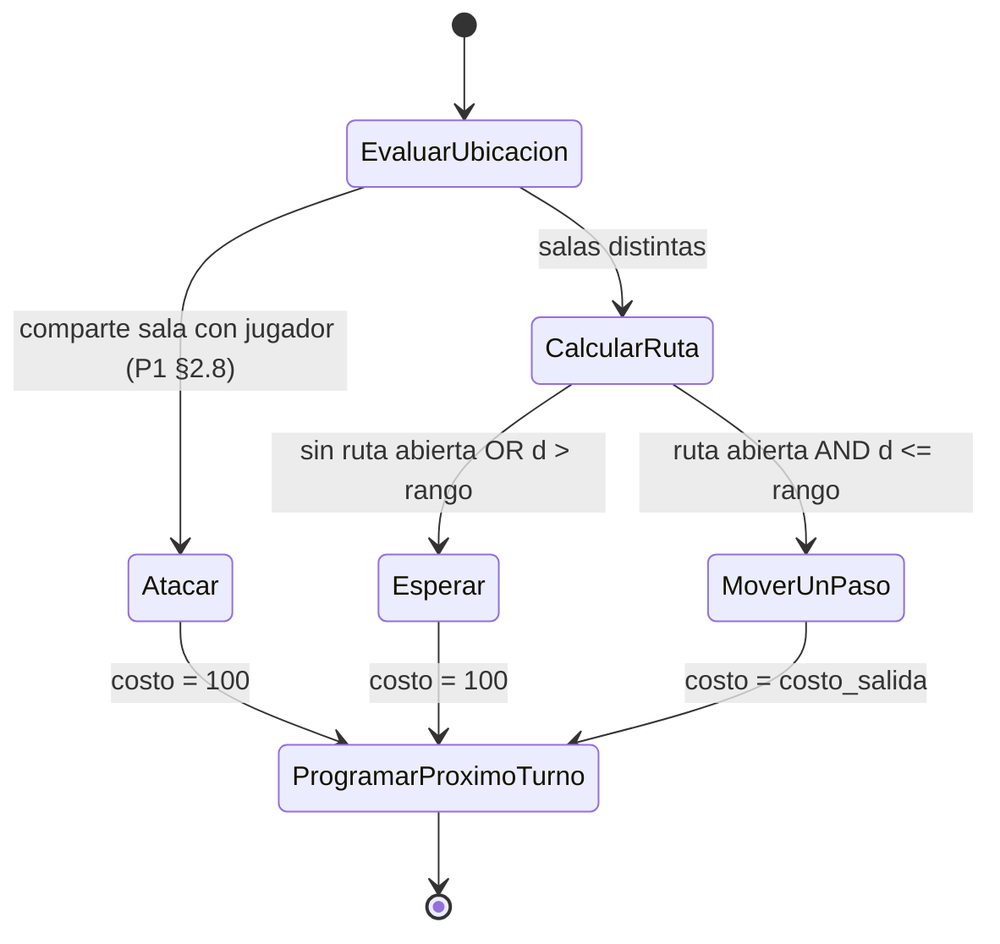

# Phase 1: Data Model — Terreno y cazador (001)

Este documento describe las entidades de datos, campos, relaciones, reglas de validación y transiciones de estado para la capacidad `001-terreno-cazador`.

---

## 1. Entidades del Dominio

### 1.1 Salida de Sala (`Exit` en C1 / `SalidaViva` en C2)

Representa la conexión bidireccional y transitable entre dos salas adyacentes de la cripta.

| Campo | Tipo | Requerido | Valor por defecto | Descripción |
| :--- | :--- | :--- | :--- | :--- |
| `direccion` | `str` | Sí | — | Orientación cardinal (`"N"`, `"S"`, `"E"`, `"O"`). |
| `destino` / `sala` | `int` | Sí | — | Identificador de la sala contigua a la que conduce. |
| `costo` | `int` | Sí | `100` | Costo de tránsito de la salida. Entero $\ge 1$. Mismo valor en ambos sentidos. |
| `cerrada` | `bool` | No | `False` | Indica si la puerta está actualmente cerrada y bloquea el paso. |
| `llave` | `Optional[str]` | No | `None` | Identificador de la llave requerida para abrir la puerta si está cerrada. |
| `cierre_automatico` | `Optional[int]` | No | `None` | Unidades de tiempo virtual tras las cuales la puerta se cierra automáticamente. |

**Reglas de validación (`FR-CAZ-01`):**
- `costo` debe ser de tipo entero positivo: `costo >= 1`.
- Si los datos de entrada omiten el campo `costo`, se inicializa automáticamente en `100`.
- **Simetría física**: Si la sala $A$ tiene una salida hacia la sala $B$ con costo $c$, la salida recíproca de $B$ hacia $A$ tiene exactamente el mismo costo $c$.

---

### 1.2 Enemigo Catálogo (`Enemy`)

Ficha arquetípica inmutable en el catálogo de entidades que define las estadísticas y el comportamiento base de un tipo de enemigo.

| Campo | Tipo | Requerido | Valor por defecto | Descripción |
| :--- | :--- | :--- | :--- | :--- |
| `id` | `str` | Sí | — | Identificador unívoco del tipo de enemigo en el catálogo. |
| `nombre` | `str` | Sí | — | Nombre legible para la interfaz y bitácora. |
| `vida_max` | `int` | Sí | — | Puntos de vida máximos del enemigo ($> 0$). |
| `ataque` | `int` | Sí | — | Valor base de ataque. |
| `defensa` | `int` | Sí | — | Valor base de defensa. |
| `velocidad` | `int` | Sí | — | Velocidad de acción ($> 0$). Determina la duración del turno. |
| `comportamiento` | `str` | Sí | — | Uno de: `"guardián"`, `"errante"`, `"rastreador"`, `"cazador"`. |
| `rango` | `Optional[int]` | Condicional | `None` | Rango máximo de persecución (en unidades de costo). Obligatorio si `comportamiento == "cazador"`. |
| `suelta` | `Optional[list[str]]`| No | `None` | Objetos que deja caer al morir. |
| `regeneracion` | `Optional[int]` | No | `None` | Puntos de curación por pulso cada 200 ticks virtuales. |

**Reglas de validación (`FR-CAZ-04`):**
- Si `comportamiento == "cazador"`, el campo `rango` es obligatorio y debe ser un entero $\ge 1$.
- Si `comportamiento != "cazador"`, `rango` se ignora o se almacena como `None`.

---

### 1.3 Instancia de Enemigo Cazador (`EnemigoInstancia`)

Instancia concreta de un enemigo viva en el mapa de la cripta durante una partida activa.

| Campo | Tipo | Requerido | Valor por defecto | Descripción |
| :--- | :--- | :--- | :--- | :--- |
| `instancia` | `str` | Sí | — | Identificador único de instancia (ej. `"cazador-1"` o `"oleada-4"`). |
| `tipo_id` | `str` | Sí | — | Referencia al `id` del arquetipo en el catálogo. |
| `vida` | `int` | Sí | — | Puntos de vida actuales ($0 \le vida \le vida\_max$). |
| `sala_actual` | `int` | Sí | — | ID de la sala que ocupa actualmente en la cripta. |
| `activa` | `bool` | Sí | `False` | `True` si ya fue activado por presencia o turno en la agenda. |
| `tiempo_siguiente`| `int` | Sí | `0` | Instante virtual del reloj en el que está programado su próximo turno. |

---

### 1.4 Cache de Trayectoria del Cazador (`RutaCazador`)

Estructura transitoria en memoria utilizada para reutilizar cálculos de trayectoria previos sin vulnerar la equivalencia con cálculo desde cero (`FR-CAZ-11`).

| Campo | Tipo | Descripción |
| :--- | :--- | :--- |
| `instancia_id` | `str` | Identificador de la instancia de cazador dueña de la ruta. |
| `puertas_version` | `int` | Versión del estado de las puertas en el instante en que se calculó la ruta. |
| `sala_jugador` | `int` | Sala en la que se encontraba el jugador al momento del cálculo. |
| `pasos` | `list[int]` | Secuencia de IDs de salas a recorrer hasta alcanzar la sala del jugador. |
| `costo_total` | `int` | Suma acumulada de los costos de las salidas que componen la ruta restante. |

**Criterio de Invalidez:**
Una `RutaCazador` queda invalidada y se descarta de inmediato si:
- `estado.puertas_version != ruta.puertas_version` (alguna puerta cambió de estado en la cripta).
- `estado.sala_actual != ruta.sala_jugador` (el jugador se movió a otra sala).
- El cazador no se encuentra en la sala esperada (ej. fue teleportado o desviado).
- `len(ruta.pasos) == 0`.

---

### 1.5 Resultado de Decisión del Cazador (`DecisionCazador`)

DTO resultante de la evaluación de turno del cazador en el motor (`C2`).

| Campo | Tipo | Valores permitidos | Descripción |
| :--- | :--- | :--- | :--- |
| `tipo` | `str` | `"atacar"`, `"mover"`, `"esperar"` | Acción seleccionada por el cazador. |
| `costo_base` | `int` | $\ge 1$ | Costo de la acción: 100 para atacar/esperar; costo de salida para mover. |
| `destino_sala` | `Optional[int]`| `int` o `None` | Sala hacia la que se mueve (si `tipo == "mover"`). |
| `direccion` | `Optional[str]`| `"N"`, `"S"`, `"E"`, `"O"` o `None` | Dirección de la salida que cruza. |
| `distancia_d` | `Optional[int]`| $\ge 0$ o `None` | Distancia mínima total calculada hasta el jugador. |

---

## 2. Diagrama de Estados de Turno del Cazador

---

## 3. Matriz de Fórmulas y Cálculos Temporales

| Caso / Evento | Fórmula del Intervalo Virtual | Referencia |
| :--- | :--- | :--- |
| Desplazamiento por salida de costo $c$ a velocidad $v$ | $\max(1, c \times 100 // v)$ | `FR-CAZ-02` |
| Ataque del cazador a velocidad $v$ | $\max(1, 100 \times 100 // v)$ | `FR-CAZ-05` (P1 §2.8) |
| Espera del cazador a velocidad $v$ | $\max(1, 100 \times 100 // v)$ | `FR-CAZ-05` |
| Cambio de velocidad en tránsito de $v_{ant}$ a $v_{nue}$ | $ahora + \max(1, restante \times v_{ant} // v_{nue})$ | `FR-CAZ-12` (P1 §2.3) |
| Desempate entre vecinas de costo mínimo | $\min_{v \in V^*} (v.id)$ | `FR-CAZ-09` |
